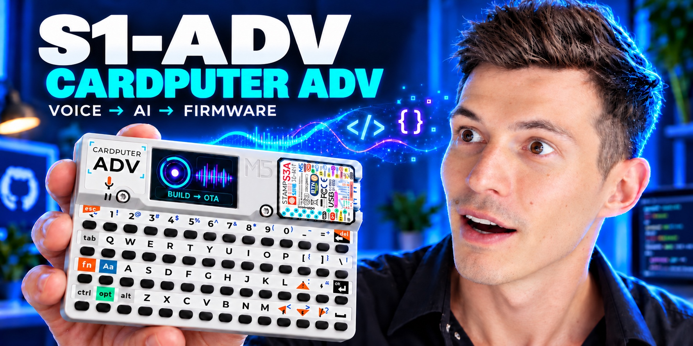

<p align="center"></p>

<p align="center">
<a href="LICENSE"></a>


</p>

# S1-ADV for Cardputer ADV

Security: [bridge/plugin review and fixes](docs/SECURITY-REVIEW-2026-10-18.md).

**S1-ADV** turns a M5Stack Cardputer ADV into a pocket workspace for your
**OpenClaw** agent: keyboard, voice, local tools and firmware you can extend.
Type a question, hold the talk button, check a reply, or use the offline apps.
The agent runs on your computer or server; the Cardputer runs this firmware.

**Video walkthrough coming soon.** Follow [s1z0v on YouTube](https://www.youtube.com/@s1z0v).

S1-ADV is experimental firmware built on Arduino/FreeRTOS, with an included
OpenClaw bridge. See [Credits](CREDITS.md) for the project origin and cover details.

[Get started](docs/GETTING-STARTED.md) · [Flash firmware](docs/FLASHING.md) · [Connect OpenClaw](docs/OPENCLAW.md) · [Troubleshooting](docs/TROUBLESHOOTING.md)

## What you can do

| On the Cardputer | What powers it |
| --- | --- |
| Keyboard chat and push-to-talk voice | Your OpenClaw agent through the included bridge |
| One configured conversation and its history | Authenticated HTTP and WebSocket feed |
| Spoken replies and an SD audio library | Server-side STT/TTS and device audio playback |
| Firmware updates over Wi-Fi | Your bridge's authenticated OTA manifest |
| Focus timer, notes, calculator, clocks, pet and games | Local firmware, with no model required |
| NES game library on SD | Nofrendo, mapper 0/4; your own ROM files |

The interface and assistant replies default to English. Russian input and
Cyrillic rendering are supported; ask explicitly for a Russian reply.
[NES games stay on SD](docs/NES.md), separate from firmware updates.

Realtime voice is an optional experimental mode with separate provider setup.
Start with text, then add ordinary push-to-talk voice.

## How it fits together

```text
Cardputer ADV  <--- Wi-Fi --->  Cardputer bridge  <--- local WS --->  OpenClaw
keyboard / mic / speaker       Node.js on your host                  your agent
```

The repository includes both sides: [firmware](bots/CardputerADV) and
[bridge](bridge). Install it as an OpenClaw plugin with setup/doctor commands,
or run the same bridge as a standalone service. The included
[setup skill](skills/s1-adv) guides your agent through the reviewed configuration;
no personal server settings or model account are bundled.

Use one device identity per bridge instance, with separate private storage for
each device. Start with a restricted chat agent; enable firmware-building rights
only when you deliberately need them. Read the [security model](SECURITY.md).

## What you need

- **M5Stack Cardputer ADV**, with ESP32-S3 and 8 MB flash. Other Cardputer models are untested.
- A USB data cable and a 2.4 GHz Wi-Fi network.
- A computer for the first USB flash: Python 3 and PlatformIO.
- An existing OpenClaw installation and a host for the bridge: Node.js 22+.
- A reachable bridge address. Use HTTPS/WSS for remote access. The firmware trusts ISRG Root X1 by default.
- For voice: FFmpeg, an STT backend and a TTS backend on the bridge host.
- Optional microSD for saved audio and extra assets.

New microphone recordings are saved as WAV files in `/recordings/YYYYMMDD/` on
microSD to keep recording startup fast as the archive grows. Voice Notes metadata
and older recordings remain in `/voice`; existing files do not need migration.

## Start here

```bash
git clone https://github.com/srg0/s1-adv.git
cd s1-adv
```

1. [Set up the bridge and generate your device token](docs/OPENCLAW.md).
2. [Build and flash the firmware over USB](docs/FLASHING.md).
3. Send one short text on the Cardputer and confirm the answer on its screen.

Prefer asking your OpenClaw agent to help? Copy the
[installation prompt](docs/OPENCLAW.md#give-this-to-your-openclaw-agent).

## Project status

S1-ADV is an independent experimental project. Its firmware began with
OmniBot; [Credits](CREDITS.md) records that origin and the retained notices.
The exact source version is defined in
[platformio.ini](bots/CardputerADV/platformio.ini). The UI includes an app menu,
assistant commands, visible Realtime microphone states, one configured chat,
an SD game library and a compact Home battery gauge. See
[controls](docs/CONTROLS.md) and [validation](docs/VALIDATION.md).
The public security fixes are retained. Public builds have not yet been tested
on a freshly provisioned physical device.

Personal provisioned binaries are deliberately excluded: Wi-Fi credentials and
device tokens may be embedded in them. Build locally with your own settings.
There is no shared hosted bridge, subscription, or bundled model account.

| Directory | Contents |
| --- | --- |
| `bots/CardputerADV/` | ESP32-S3 firmware, partition layouts and host tests |
| `bridge/` | OpenClaw adapter, examples and synthetic smoke tests |
| `skills/s1-adv/` | Optional OpenClaw setup skill |
| `docs/` | Setup, flashing, architecture and troubleshooting |
| `CREDITS.md` | Project origin, upstream acknowledgements and image provenance |

## Development

```bash
cd bridge
npm ci
npm run test:security
npm run smoke
```

The smoke test uses a local mock gateway and generated tone fixtures. Install
FFmpeg first. See [contributing](CONTRIBUTING.md) and [security](SECURITY.md).

## Creator and credits

S1-ADV is maintained by **Sergey Sizov**.

[Instagram @s1z0v](https://www.instagram.com/s1z0v/) ·
[YouTube @s1z0v](https://www.youtube.com/@s1z0v) ·
[GitHub srg0](https://github.com/srg0)

Originally based on [nazirlouis/OmniBot](https://github.com/nazirlouis/OmniBot).
Thanks to its authors, [M5Stack](https://github.com/m5stack/M5Cardputer),
[OpenClaw](https://github.com/openclaw/openclaw) and the other dependency authors.
See [Credits](CREDITS.md) and [MIT license](LICENSE) for attribution.
